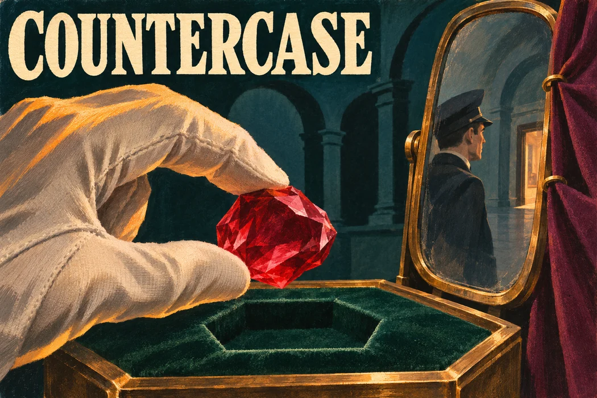
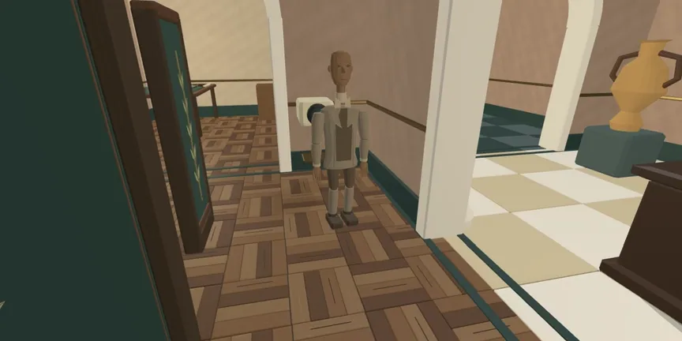

# Countercase

Countercase is a walk-through museum mystery for two on SPECS. Stage a ruby theft for a friend and hand them the case. They enter through the foyer, wind the clock back and follow the recording through the museum to find out who could have reached the display.



Six seconds into **The Missing Ruby**, the entrance camera sees the courier. Look into the mirror in that same recording and the guard is across the room. That gives two people an alibi. Close the little curtain over the mirror in a copy of the case and play the theft again. The courier still has an alibi, but either the guard or the conservator could have taken the ruby.

## Play in Lens Studio

1. Install Git LFS and run `git lfs install`. Clone this repository with `git clone` and its HTTPS URL. The museum models and Snap packages use LFS. If your checkout contains pointer files, run `git lfs pull` from the repository root. Open **Countercase.esproj** there in **Lens Studio 5.23.2** and let asset import and TypeScript compilation finish. [Lens Studio 5.23.2](https://ar.snap.com/download/v5-23-2)
2. Open **Window → Preview** and choose **Interactive** in the preview-source picker. The first case begins in the foyer. Look for the clock and the case file on the wooden desk.
3. Focus the Preview. Use **W/A/S/D** to walk and **right-drag** to look around. Hover over the clock face until its inscription appears, then click to play or pause. With the clock paused, use **Previous frame** or **Next frame** at its sides to reach **6.0 s**. The face resumes from the time you selected. The control below it, **Replay from alarm**, starts the recording again at the alarm. [Interactive Preview controls](https://developers.snap.com/lens-studio/lens-studio-workflow/previewing-your-lens#interactive-preview-mode)
4. Find the entrance camera in the hall and choose **Watch this view**. At the evidence bench, select the courier on the recording, then use the pin handle beside the glass. Choose the conservator and press **Check accusation**. Read the names on the paper. The courier's alibi still allows two people to have taken the ruby.
5. At the same instant, select the figure in the mirror on the recording. Pin that sighting and check the accusation again. After the case is solved, choose **Replay the evidence** at the bench. Your pins are still there. Select the courier's glass, **Remove evidence** and check again. **Undo evidence removal** restores the pin for another check. Each object also accepts a simulated point and pinch.

For a wide desktop walkthrough, use **No Simulation** in the Interactive Preview and set **Settings → Device Type Override → SPECS**. This keeps the hand controls available. We captured the foyer in a landscape Preview at roughly 2:1 and a 60° field of view. Lens Studio 5.23.2 kept those settings when we reopened the project, but reset the panel height and viewing angle. Resize the Preview to landscape and right-drag slightly down until you see the clock face, the glass on the desk and the display through the arch. Switch to the SPECS device profile to check the glasses' field of view. [Snap's Preview settings for glasses](https://developers.snap.com/spectacles/get-started/start-building/preview-panel)

### Give someone your version



In the first shot, the detective sees an anonymous figure pass the camera. The second shot comes from the author's rehearsal. The conservator's fingers close around the ruby before the hand lifts it from the socket.

Use the **Stage a theft** file to copy the current case. Move the mirror curtain, then use the lid at the workbench to **Test case**. If two thefts fit the recording, **Keep different thefts** lets you keep that as the puzzle. Choose **Pass the case** and let the next player **Open the case** in the same session. They receive the recording and physical clues. The casting and private staging stay with the author.

The shelf also holds **The Packing Room**. There, seeing who lifted the ruby settles only part of the case. A mark on the rim, sightings near a partition and the final contents of a box answer different questions about who carried it away. Copies, edits and investigations live for the current Lens session.

## How the evidence works

The author places actors on tracks. For each half-second of a case, the TypeScript model tests a fixed camera's view against the room. A reflection must reach the open, front-facing part of the mirror and both legs of its sight line must clear the obstacles. Walking closer helps a player inspect the glass. It never grants the fixed camera a different angle on the crime.

The detective receives a sealed recording. When they check an accusation, the game enumerates legal histories under the same movement and handling rules, then compares the observations they pinned. If two histories still fit, tabletop reconstructions at the evidence bench let you compare the two people reaching for the ruby at the same instant. A box inspection establishes where the ruby ended up. Its contents alone cannot tell you when someone put it there.

| In the source | What to look for |
| --- | --- |
| [Case model](Assets/Domain/) | Actor tracks, sight lines, mirror intersections, sealed recordings and competing explanations |
| [Player actions](Assets/Runtime/PlayTable.ts) | The clock, curtain, witness camera, evidence glass, case lid and accusation stamp |
| [Case flow](Assets/Runtime/MuseumGame.ts) | Handoff between author and detective, replay and reveal |
| [Museum art](Assets/Art/TableKit/) | The connected building, carved figures and props used at the evidence stations |

## Run the checks

These checks run from the repository root in PowerShell with Node.js and npm.

```powershell
.\Tests\Domain\run.ps1
.\Tests\Detective\run.ps1
.\Tests\MuseumGame\run.ps1
```

The first run needs npm access for the pinned TypeScript compiler. The domain checks exercise the mirror and alternative histories. The other suites exercise pinning, accusation, changing a case and handing it over.

In **Lens Studio Interactive Preview**, the public-recording LEAF scenario pinned the courier first and the guard second. It checked that an accusation changed from two possible suspects to one, then removed and restored the courier pin to check the result both ways. The museum walkthrough was captured in Preview. Physical SPECS testing remains open. [LEAF scenarios for Lens Studio](Assets/Tests/Leaf/)

## Materials

Countercase uses Snap's SPECS Base Template, Spectacles Interaction Kit 2.0, Spectacles UI Kit 2.0 and LEAF 2.0. The museum geometry, puppet rigs, evidence rules and case scripts were made for this project. The two framed paintings and the illustrated project poster were generated for Countercase. The oak and plaster textures were generated procedurally. [TableKit asset notes](Assets/Art/TableKit/README.md) · [Snap's Interaction Kit guide](https://developers.snap.com/spectacles/spectacles-frameworks/spectacles-interaction-kit/get-started)
