Sunfall is a lens for Snap Specs that shows where sunlight will fall in your room at any hour of any day of the year. You look at the window, take the sun in your hand and move it: along its arc the hour changes, up or down the sky the date changes, and the patch of light from your window slides across the real floor, walls and furniture as it would on that day.

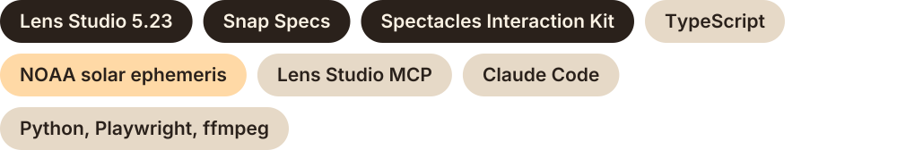

<table>
<tr>
<td width="33%">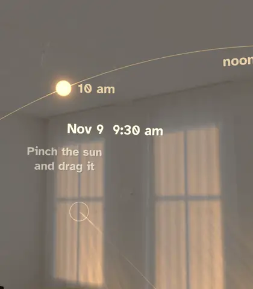</td>
<td width="33%">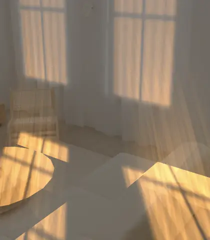</td>
<td width="33%">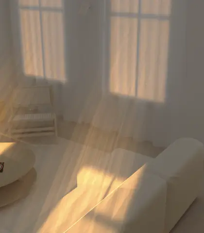</td>
</tr>
<tr>
<td>Drag the sun and the light follows</td>
<td>Play the day to map the hours of sun</td>
<td>Noon on December 21 and on June 21</td>
</tr>
</table>

These loops are real Lens Studio Preview recordings of the lens.

## Who it's for

You usually see an apartment once, at whatever hour the agent could meet you, and then you live there for a year. At home the same question comes back in smaller forms: will the plant by the window get enough sun in January, will the desk catch glare at 3 pm, which corner stays warm in winter? People answer it by guessing or by waiting a year.

Sunfall is for people deciding where things go in a room (plants, a desk, a reading chair) and for people viewing a flat they are about to rent or buy, who need to know what the light is like at the times they can't visit.

## Try it in Lens Studio

1. Install [Lens Studio 5.23.2](https://ar.snap.com/download/v5-23-2) and Git LFS (`git lfs install`), clone this repository and open `Sunfall.esproj`. Wait until the assets import and TypeScript compiles.
2. Open **Preview**, choose **Interactive**, the **Sunlit Room** environment and the **SPECS** device.
3. Walk with **W A S D**, go down and up with **Q E**, look around with a right-drag. A left click is a pinch.
4. Turn right to face the three curtained windows and click the middle one. Light comes in and the sun appears above the window.
5. Look up and to the left, take the sun and drag it. Sideways changes the hour, up and down changes the date.
6. Glance down for the three buttons: **Play the day**, **Add a plant** (then click a spot on the floor) and **Now**.

Inputs on the `Sunfall` script component:

| Input | Default | What it does |
| --- | --- | --- |
| `windowAzimuth` | 200 | The compass bearing the window faces, in degrees (200 is south-south-west) |
| `startDay`, `startMinutes` | today, 10:30 am | The date and time the lens opens on (`startDay = -1` means today) |
| `autoMarkAll` | off | Lights every known window at start instead of waiting for pinches |
| `dockAtStart` | off | Shows the buttons right away instead of after the first drag |
| `timeScale` | 1 | Slows every animation down, for recording the Preview on slow machines |
| `demoScript` | empty | A list of timed actions (`mark`, `grab`, `sun`, `press`, `floor`) that drives the lens with a visible hand cursor, for repeatable recordings |

## What you can do

<table>
<tr>
<td width="33%">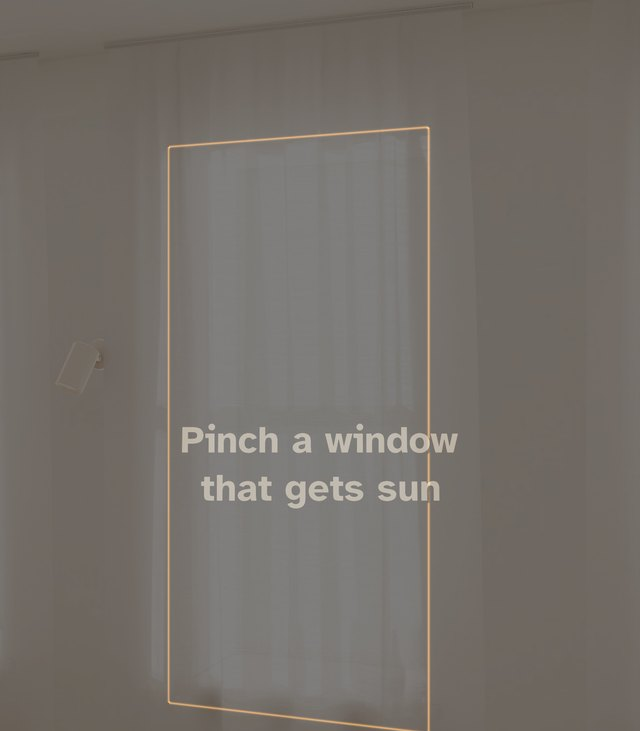</td>
<td width="33%">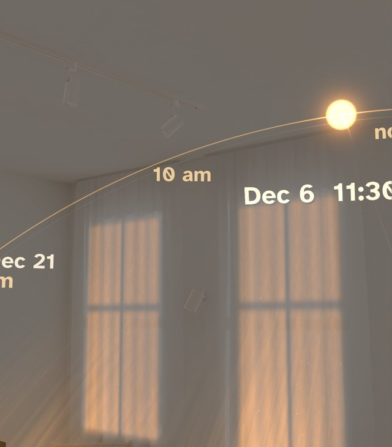</td>
<td width="33%">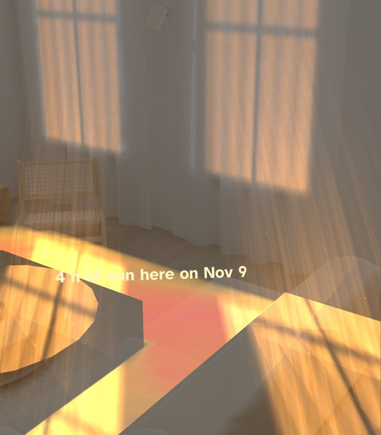</td>
</tr>
<tr>
<td><b>Mark the windows.</b> Pinch each window that lets sun in. It snaps to the frame, and its light comes in at once.</td>
<td><b>Drag the sun.</b> The arc for today stays on screen with hour labels. While you drag, the June 21 and December 21 arcs appear, so you can see the whole year's range.</td>
<td><b>Play the day.</b> The sun runs from sunrise to sunset in nine seconds and paints a map of sun hours on the floor. The spot that gets the most is labeled.</td>
</tr>
<tr>
<td>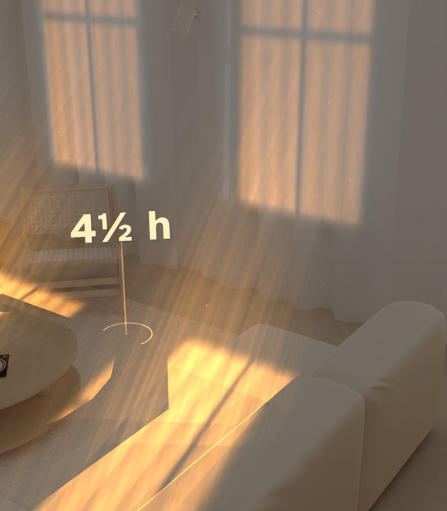</td>
<td>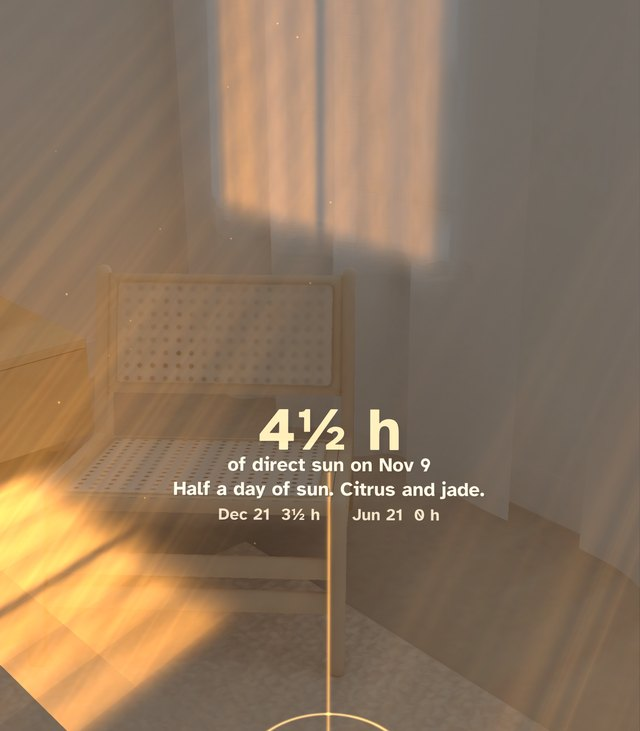</td>
<td>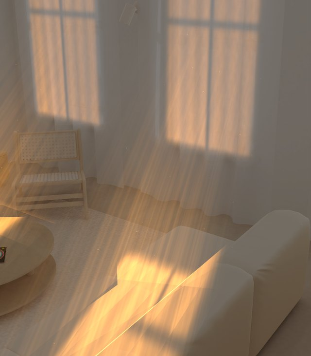</td>
</tr>
<tr>
<td><b>Add a plant.</b> Pinch the floor where a pot will stand. From across the room the card shows only the number of hours.</td>
<td><b>Walk up to it.</b> Closer than about two meters the card adds what grows in that light and the hours on December 21 and June 21.</td>
<td><b>Compare seasons.</b> The same noon in December: the sun is low and the light reaches across the floor to the sofa.</td>
</tr>
</table>

| December 21, noon | June 21, noon |
| --- | --- |
|  | 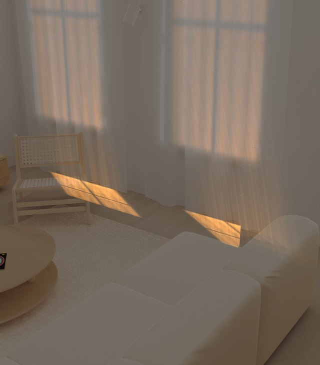 |

**Now** brings the sun back to the current time. You can keep up to three plants; when you add a fourth, the oldest one goes away.

## How it works

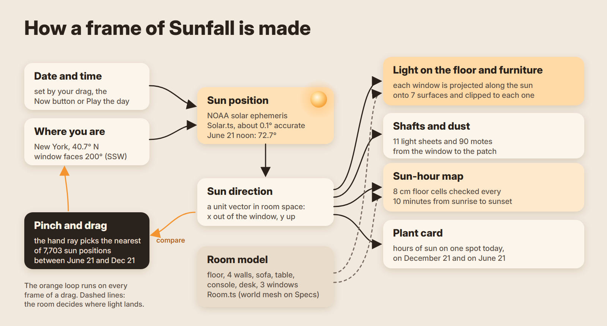

### The sun

[`Assets/Sunfall/Solar.ts`](Assets/Sunfall/Solar.ts) implements the NOAA low-precision solar ephemeris, which gives the azimuth and elevation of the sun for any date, time and place to about 0.1°. We checked it against published values: in New York the sun stands at 72.7° on June 21 at 12:57 pm and at 25.8° on December 21 at 11:55 am. The direction is then turned into room coordinates relative to the window, whose outward normal is `+X`.

### Dragging the sun

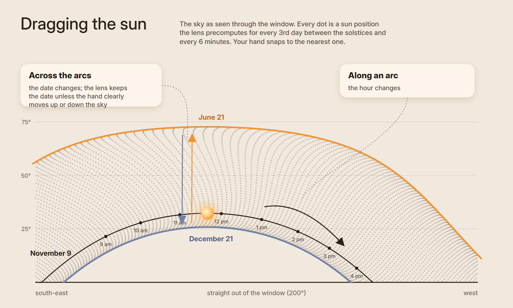

When the lens starts, it computes the sun direction for every third day between June 21 and December 21 and every six minutes from 4 am to 9 pm: 7,703 directions above or near the horizon. During a drag it compares the direction your hand points with all of them and takes the closest, then refines the minute. It keeps the current date unless your hand moves at least 2° further up or down the sky than the best match on that date, so a sideways drag never jumps between days.

### The light on the room

Each window is a rectangle with a cross bar. For every surface that can catch light (the floor, the four walls and the tops of the sofa, the coffee table and the console), the lens projects the window corners along the sun direction onto that surface's plane, clips the polygon to the surface with Sutherland and Hodgman clipping, and builds a mesh. The result has sharp edges and the cross bar falls in the right place, even when the patch is split between the floor and a wall. The brightness of each patch follows the angle at which the sunlight meets the surface.

Between the window and the patch there are eleven sheets of light and ninety drifting motes of dust, and the curtain of a lit window glows. Furniture is also drawn as invisible boxes that write only depth, so light that would fall behind the sofa is hidden.

### Hours of sun

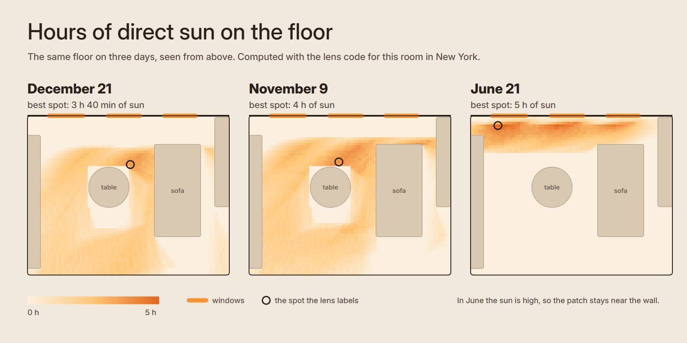

The floor is split into 8 cm cells. For each cell, every ten minutes from sunrise to sunset, the lens checks whether the straight line toward the sun leaves the room through a window without hitting furniture, and adds up the hours. To stay fast it only tests cells inside the floor shadow of each window for that moment. The same test gives the numbers on a plant card for today, December 21 and June 21.

The maps above were computed by a Python port of the same code for this room. In June the sun is high, so the light stays in a strip by the wall; in December it reaches across the room, and the brightest spot on November 9 gets 4 hours, the same number the lens labels.

### The room

On Specs the surfaces would come from the world mesh. Lens Studio's Interactive Preview rooms don't answer world queries: our first probe cast 576 rays and got back a single flat test plane. So [`Assets/Sunfall/Room.ts`](Assets/Sunfall/Room.ts) describes the Sunlit Room preview by hand.

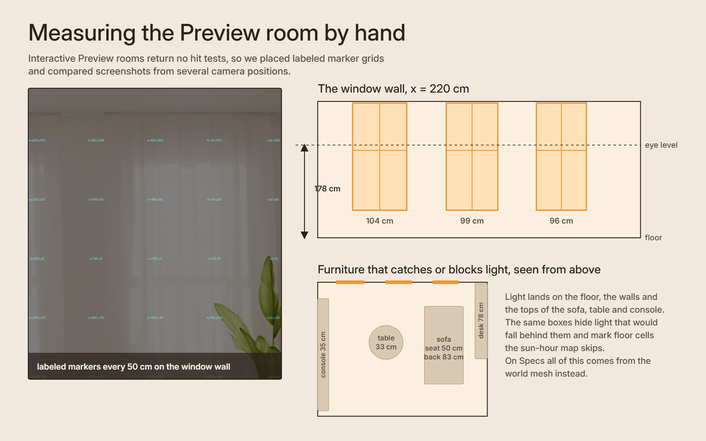

We placed grids of labeled markers at a guessed floor height and on the window wall, took Preview screenshots from several camera positions, and used the parallax between them to find the floor (178 cm below eye level), the window wall and the three window bays. The furniture boxes were fitted the same way.

## Designing for glasses

- **The display adds light and can't darken anything**, and sunlight is exactly what an additive display draws well. Everything in the lens is light: warm patches, shafts, a glowing sun, cream text.
- **The main control is the sun itself.** There are only three buttons, 6 cm discs that follow you lazily about half a meter ahead and below eye level. They appear when you glance down and hide while you drag.
- **Text is short and sized for distance.** Labels face you, the hint at the start is one line, and the plant card shows just the number until you walk up to it.
- **The first ten seconds teach the gesture.** The lens asks for one pinch on a window, the light comes in, and the next hint points at the sun.

## Project layout

| Path | What's there |
| --- | --- |
| [`Assets/Sunfall/Sunfall.ts`](Assets/Sunfall/Sunfall.ts) | The lens: windows, light projection, shafts and dust, sun drag, sun-hour map, plants, buttons, demo autopilot |
| [`Assets/Sunfall/Solar.ts`](Assets/Sunfall/Solar.ts) | Sun position, sunrise and sunset, date and time labels |
| [`Assets/Sunfall/Room.ts`](Assets/Sunfall/Room.ts) | Surfaces, windows and furniture of the Preview room, ray casts and the sun-hour test |
| `Assets/Sunfall/Textures` | Window light, light shafts, glow, sun, heat ramp and button discs, generated with Python |
| `Assets/Sunfall/Materials` | An additive material for light and an alpha material for text and UI |
| [`devpost/design-brief.md`](devpost/design-brief.md) | The planning brief written with the Devpost Learn skill pack |
| `docs/` | Images for this README |
| [`media/`](media/README.md) | The code that renders the demo video, the README diagrams and the gallery, plus the three raw Preview takes |

## How it was built

We planned the lens with the [Devpost Learn skill pack](https://github.com/challengepost/learn-specs); its design brief is in [`devpost/design-brief.md`](devpost/design-brief.md). Claude Code built it in Lens Studio through the Lens Studio MCP: it created the scene object and materials, set script inputs, imported textures, recompiled TypeScript, ran the lens, moved the Preview camera and took Preview screenshots, which we used to measure the room and to review each change.

The demo video is made in code as well ([`media/`](media/README.md)). It is an HTML page with one `renderAt(time)` function, rendered frame by frame with Playwright and encoded with ffmpeg; the music and every sound effect are synthesized in Python and placed on the picture's events. The lens footage in it is a real Lens Studio Preview recording. The Preview runs at about 3 frames per second on our laptop, so we recorded it with `timeScale = 0.1`, driven by `demoScript`, and sped the recording back up ten times.

## Limits of this version

- The city is New York and the window direction is an inspector input. On Specs both would come from the device location and compass.
- The room is the measured Preview room. On Specs the surfaces would come from the world mesh and windows would be found automatically.
- Buildings and trees outside are not taken into account, so the lens shows the sun a window could get, not what a neighbour's wall might block.

Fonts: [Atkinson Hyperlegible](https://brailleinstitute.org/freefont) (SIL Open Font License).
